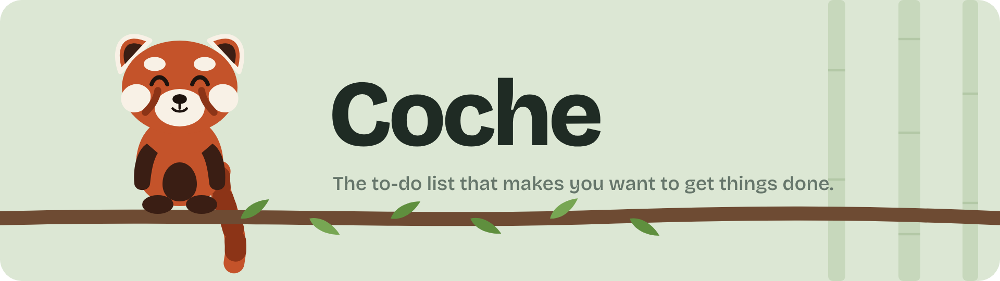

<p align="center">
  <picture>
    <source media="(prefers-color-scheme: dark)" srcset="docs/images/banner-dark-en.png">
    
  </picture>
</p>

<p align="center">
  <a href="README.md">Français</a> · <b>English</b>
</p>

<p align="center">
  <a href="https://github.com/the-panda-roux-38/coche/releases/latest"></a>
  <a href="https://github.com/the-panda-roux-38/coche/releases"></a>
  
  <a href="LICENSE"></a>
  <a href="https://tauri.app"></a>
</p>

<p align="center">
  <a href="https://github.com/the-panda-roux-38/coche/releases/latest">
    
  </a>
</p>

---

**Coche** (French for "tick") is a small to-do list for Windows. It starts with your PC, sits quietly next to the clock, and sends you a few reminders at random times during the day.

No account, no subscription, no cloud: your lists stay on your computer. And a red panda keeps you company while you work through them.

> [!NOTE]
> The interface is in French for now. An English version is on the wish list, and contributions are welcome.

<p align="center">
  
</p>

## Why Coche?

Most to-do apps count what you **haven't** done: overdue items in red, broken streaks, guilt-tripping notifications. Coche does the opposite. It only counts what's done, and every task you tick off grows a leaf on the panda's branch.

<table>
<tr>
<td width="50%" valign="top">

</td>
<td width="50%" valign="top">

**A red panda that reacts**
It hops when you tick a task, raises its arms when a list is done, and naps when there's nothing left or it's getting late.

**Random reminders**
From 0 to 8 a day, at random times within the hours you choose. Never while the window is already open.

**A priority for the day**
A star puts one task front and centre, and the panda reminds you about it.

**Instant capture**
`Ctrl + Alt + H` from anywhere, or just start typing in the window.

**Several lists**
Personal, Home, Studies… whatever you like.

**A fresh start every day**
Yesterday's finished tasks disappear; the weekly counter remembers them.

</td>
</tr>
</table>

<p align="center">
  <br>
  <sub>Dark mode follows your Windows setting automatically.</sub>
</p>

## Install

1. Download **`Coche_x.y.z_x64-setup.exe`** from the [latest release](https://github.com/the-panda-roux-38/coche/releases/latest).
2. Double-click it. No administrator rights needed.
3. If Windows shows "Windows protected your PC", click **More info**, then **Run anyway**.
4. On the last screen, keep **Create a desktop shortcut** and **Launch Coche** ticked.

Coche will then start with your PC. You can turn that off in the settings.

> [!NOTE]
> The Windows warning appears because Coche isn't signed with a paid certificate. All the code is readable here, and every installer is built by GitHub from this code.

### Updates

Coche checks for new versions on its own, at startup and every 6 hours. When one is available, an update banner appears at the top of the window. One click and Coche updates and restarts, without touching your tasks. Updates are signed, so only the project's author can publish them.

### Uninstall

The easiest way: **Settings → Uninstall Coche** (*Désinstaller Coche*), or **Start menu → Désinstaller Coche**.

> [!TIP]
> When Windows 11's Smart App Control is on, uninstalling from *Settings → Apps* is blocked ("Error launching installer"). The two options above always work.

Your tasks stay on the PC after uninstalling, unless you tick the box to delete them.

## Usage

| Action | How |
| --- | --- |
| Add a task from anywhere | `Ctrl + Alt + H` |
| Add a task in the window | Start typing, then `Enter` |
| Tick a task | Click the circle |
| Set the priority of the day | Click the star (on hover) |
| Edit a task | Double-click its text |
| Rename a list | Double-click the list |
| Delete a list | Right-click the list |
| Close the settings | `Esc` |

Closing the window doesn't quit Coche: it moves next to the clock and keeps sending reminders. To quit for real, right-click its icon and choose **Quitter**.

### Customise the reminders

The reminder sentences live in a plain text file: **Settings → Modifier les messages des rappels**. Three variables are available:

| Variable | Replaced with |
| --- | --- |
| `{tache}` | a randomly picked task |
| `{restant}` | the number of tasks left |
| `{fait}` | the number of tasks done today |

## Privacy

Everything stays on your PC, in `%APPDATA%\fr.pandaroux.coche\`. Coche doesn't send anything anywhere. The only connection it makes is the update check on GitHub.

## For developers

Coche is built with [Tauri 2](https://tauri.app): a framework-free HTML, CSS and JavaScript interface, and a Windows side in Rust.

### Requirements

- [Node.js](https://nodejs.org) (LTS)
- [Rust](https://rustup.rs)
- [Microsoft C++ Build Tools](https://visualstudio.microsoft.com/visual-cpp-build-tools/) with "Desktop development with C++"

### Run the project

```bash
npm install        # installs the Tauri CLI and the font
npm run dev        # runs Coche in development mode
npm run build      # builds the installer into src-tauri/target/release/bundle/nsis/
```

To work on the design, you can also open `src/index.html` straight in a browser: data is then stored in the browser.

### Layout

```
src/                  the interface
  index.html          window structure and the panda (SVG)
  style.css           colours, panda animations
  app.js              lists, sounds, settings, the panda's mood
src-tauri/            the Windows side (Rust)
  src/main.rs         storage, tray icon, autostart, shortcut, reminders, updates
  tauri.conf.json     app and installer configuration
  windows/hooks.nsh   installer and uninstaller tweaks
.github/workflows/    building and publishing releases
app-icon.svg          source icon (npm run icons to regenerate)
```

### Publish a release

GitHub builds and signs the installer on its own.

1. Once: add the signing private key under **Settings → Secrets and variables → Actions**, named `TAURI_SIGNING_PRIVATE_KEY`. The matching public key is in `src-tauri/tauri.conf.json`.
2. For each release: bump the version in `src-tauri/tauri.conf.json`, then
   ```bash
   git tag v0.3.0
   git push origin v0.3.0
   ```

A few minutes later the release shows up under **Releases**, and installed copies of Coche offer the update.

> [!IMPORTANT]
> If you fork the project, generate your own key pair with `npx tauri signer generate`, then replace the public key and the repository URL in `src-tauri/tauri.conf.json`.

## Contributing

Ideas, bug reports and suggestions are welcome in the [Issues](https://github.com/the-panda-roux-38/coche/issues). For code changes, open a pull request explaining what it changes and why.

## License

Coche is released under the [MIT license](LICENSE): use it, change it and share it freely.

The [Bricolage Grotesque](https://github.com/ateliertriay/bricolage) typeface is licensed under the SIL Open Font License.

<p align="center">
  <sub>Made with care by <a href="https://github.com/the-panda-roux-38">Panda</a>, to move forward one small step at a time.</sub>
</p>
