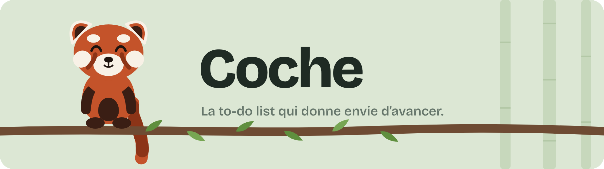
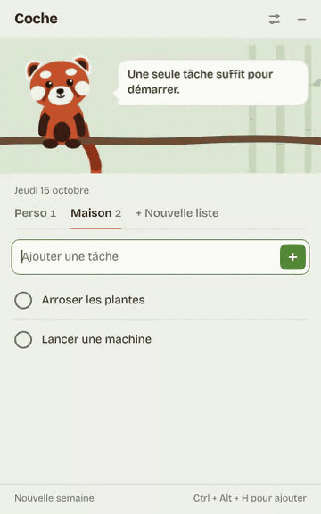
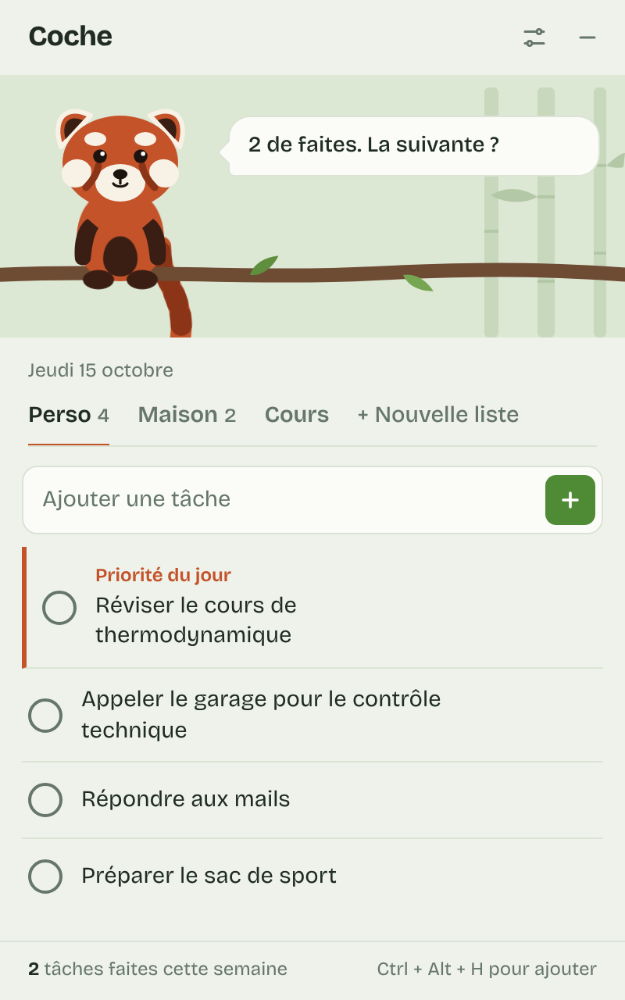
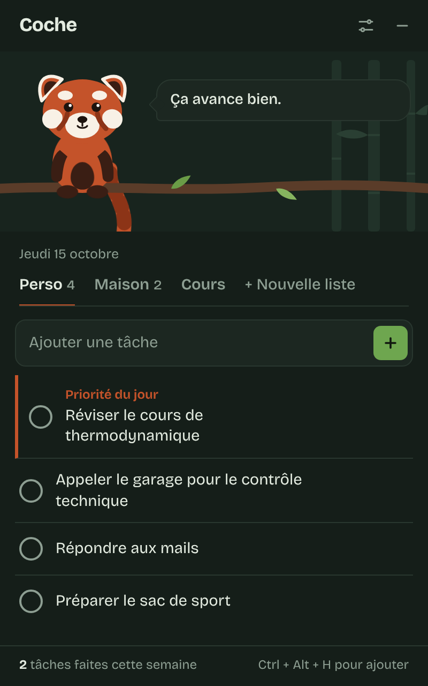

<p align="center">
  <picture>
    <source media="(prefers-color-scheme: dark)" srcset="docs/images/banner-dark.png">
    
  </picture>
</p>

<p align="center">
  <b>Français</b> · <a href="README.en.md">English</a>
</p>

<p align="center">
  <a href="https://github.com/the-panda-roux-38/coche/releases/latest"></a>
  <a href="https://github.com/the-panda-roux-38/coche/releases"></a>
  
  <a href="LICENSE"></a>
  <a href="https://tauri.app"></a>
</p>

<p align="center">
  <a href="https://github.com/the-panda-roux-38/coche/releases/latest">
    
  </a>
</p>

---

**Coche** est une petite liste de tâches pour Windows. Elle s'ouvre avec le PC, reste discrète près de l'horloge, et t'envoie quelques rappels au hasard dans la journée.

Pas de compte, pas d'abonnement, pas de cloud : tes listes restent sur ton ordinateur. Et un panda roux te tient compagnie pendant que tu avances.

<p align="center">
  
</p>

## Pourquoi Coche ?

La plupart des to-do lists comptent ce que tu n'as **pas** fait : retards en rouge, séries qui se cassent, notifications qui culpabilisent. Coche fait l'inverse. Elle ne compte que ce qui est fait, et chaque tâche cochée fait pousser une feuille sur la branche du panda.

<table>
<tr>
<td width="50%" valign="top">

</td>
<td width="50%" valign="top">

**Un panda roux qui réagit**
Il saute quand tu coches, lève les bras quand une liste est finie, et fait la sieste quand il n'y a rien à faire ou qu'il est tard.

**Des rappels au hasard**
De 0 à 8 par jour, à des heures tirées au sort dans ta plage horaire. Jamais quand la fenêtre est déjà ouverte.

**Une priorité du jour**
Une étoile met une tâche en avant, et le panda te la rappelle.

**Ajout éclair**
`Ctrl + Alt + H` depuis n'importe où, ou commence simplement à taper dans la fenêtre.

**Plusieurs listes**
Perso, Maison, Cours… comme tu veux.

**Chaque jour repart propre**
Les tâches faites la veille disparaissent, le compteur de la semaine les garde.

</td>
</tr>
</table>

<p align="center">
  <br>
  <sub>Le mode sombre suit automatiquement celui de Windows.</sub>
</p>

## Installer

1. Télécharge **`Coche_x.y.z_x64-setup.exe`** depuis la [dernière version](https://github.com/the-panda-roux-38/coche/releases/latest).
2. Double-clique dessus. Pas besoin d'être administrateur.
3. Si Windows affiche « Windows a protégé votre ordinateur », clique sur **Informations complémentaires** puis **Exécuter quand même**.
4. À la fin, laisse cochées **Créer un raccourci sur le bureau** et **Lancer Coche**.

Coche se relancera ensuite à chaque démarrage du PC. Tu peux le désactiver dans les réglages.

> [!NOTE]
> L'avertissement de Windows apparaît parce que Coche n'est pas signé avec un certificat payant. Le code est entièrement lisible ici, et chaque installateur est fabriqué par GitHub à partir de ce code.

### Mises à jour

Coche vérifie tout seul s'il existe une nouvelle version, au démarrage puis toutes les 6 heures. Quand c'en est une, un bandeau **Mettre à jour** apparaît en haut de la fenêtre. Un clic, et Coche se met à jour puis se relance, sans toucher à tes tâches. Les mises à jour sont signées : seul l'auteur du projet peut en publier.

### Désinstaller

Le plus simple : **Réglages → Désinstaller Coche**, ou **menu Démarrer → Désinstaller Coche**.

> [!TIP]
> Si le « contrôle intelligent des applications » de Windows 11 est activé, la désinstallation depuis *Paramètres → Applications* est bloquée (message « Error launching installer »). Les deux chemins ci-dessus fonctionnent dans tous les cas.

Tes tâches restent sur le PC après la désinstallation, sauf si tu coches la case pour les supprimer.

## Utiliser

| Action | Comment |
| --- | --- |
| Ajouter une tâche depuis n'importe où | `Ctrl + Alt + H` |
| Ajouter une tâche dans la fenêtre | Commencer à taper, puis `Entrée` |
| Cocher une tâche | Clic sur le rond |
| Choisir la priorité du jour | Clic sur l'étoile (au survol) |
| Modifier une tâche | Double-clic sur son texte |
| Renommer une liste | Double-clic sur la liste |
| Supprimer une liste | Clic droit sur la liste |
| Fermer les réglages | `Échap` |

Fermer la fenêtre ne quitte pas Coche : il se range près de l'horloge et continue d'envoyer les rappels. Pour le quitter vraiment : clic droit sur son icône, puis **Quitter**.

### Personnaliser les rappels

Les phrases des rappels sont dans un simple fichier texte : **Réglages → Modifier les messages des rappels**. Trois variables sont disponibles :

| Variable | Remplacée par |
| --- | --- |
| `{tache}` | une tâche tirée au sort |
| `{restant}` | le nombre de tâches à faire |
| `{fait}` | le nombre de tâches faites aujourd'hui |

## Vie privée

Tout reste sur ton PC, dans `%APPDATA%\fr.pandaroux.coche\`. Coche n'envoie rien nulle part. La seule connexion qu'il fait est la vérification des mises à jour sur GitHub.

## Pour les développeurs

Coche est fait avec [Tauri 2](https://tauri.app) : une interface en HTML, CSS et JavaScript sans framework, et une partie Windows en Rust.

### Prérequis

- [Node.js](https://nodejs.org) (version LTS)
- [Rust](https://rustup.rs)
- [Microsoft C++ Build Tools](https://visualstudio.microsoft.com/fr/visual-cpp-build-tools/), option « Développement Desktop en C++ »

### Lancer le projet

```bash
npm install        # installe l'outil Tauri et la police
npm run dev        # lance Coche en mode développement
npm run build      # crée l'installateur dans src-tauri/target/release/bundle/nsis/
```

Pour travailler sur le design, tu peux aussi ouvrir `src/index.html` directement dans un navigateur : les données vont alors dans le navigateur.

### Organisation

```
src/                  l'interface
  index.html          structure de la fenêtre et du panda (SVG)
  style.css           couleurs, animations du panda
  app.js              listes, sons, réglages, humeur du panda
src-tauri/            la partie Windows (Rust)
  src/main.rs         sauvegarde, icône, démarrage auto, raccourci, rappels, mises à jour
  tauri.conf.json     configuration de l'appli et de l'installateur
  windows/hooks.nsh   ajustements de l'installateur et du désinstalleur
.github/workflows/    fabrication et publication des versions
app-icon.svg          icône source (npm run icons pour la régénérer)
```

### Publier une version

GitHub fabrique et signe l'installateur tout seul.

1. Une seule fois : ajoute la clé secrète de signature dans **Settings → Secrets and variables → Actions**, sous le nom `TAURI_SIGNING_PRIVATE_KEY`. La clé publique correspondante est dans `src-tauri/tauri.conf.json`.
2. À chaque version : change le numéro dans `src-tauri/tauri.conf.json`, puis
   ```bash
   git tag v0.3.0
   git push origin v0.3.0
   ```

Quelques minutes plus tard, la version apparaît dans **Releases**, et les Coche déjà installés la proposent.

> [!IMPORTANT]
> Si tu forkes le projet, génère ta propre paire de clés avec `npx tauri signer generate`, puis remplace la clé publique et l'adresse du dépôt dans `src-tauri/tauri.conf.json`.

## Contribuer

Les idées, signalements de bugs et propositions sont les bienvenus dans les [Issues](https://github.com/the-panda-roux-38/coche/issues). Pour une modification de code, ouvre une *pull request* en expliquant ce qu'elle change et pourquoi.

## Licence

Coche est distribué sous [licence MIT](LICENSE) : tu peux l'utiliser, le modifier et le partager librement.

La police [Bricolage Grotesque](https://github.com/ateliertriay/bricolage) est distribuée sous licence SIL Open Font License.

<p align="center">
  <sub>Fait avec soin par <a href="https://github.com/the-panda-roux-38">Panda</a>, pour avancer un petit pas à la fois.</sub>
</p>
